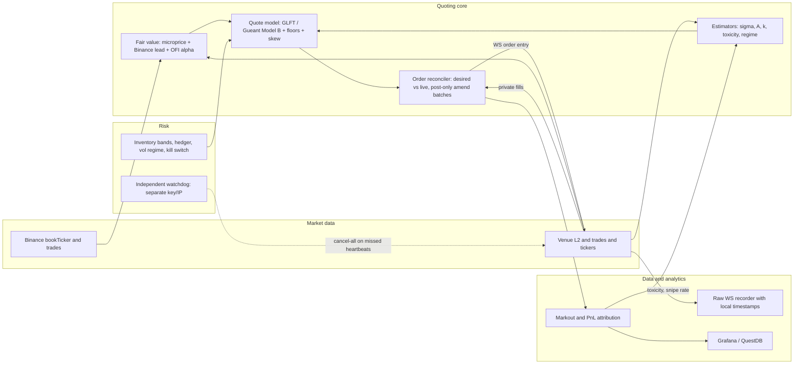

# Crypto Market-Making Strategy — Design Document

Target venues: OKX, Binance, Bybit (USDT perpetuals first, spot later), via their public APIs.
Status: design v0.1, synthesised from the research in `resource/` on 2026-09-20. Nothing here is implemented yet.

Every design decision below cites the research file that supports it (`R1`–`R5`, see §12). Numbers marked *(start)* are starting points to be recalibrated from our own data, not constants.

---

## 1. Thesis: where the P&L actually comes from

The literature and practitioner evidence agree on one uncomfortable fact: **naive quoting at the touch does not pay for its adverse selection.**

- A 125.8M-fill simulation of a back-of-queue touch quoter on Bybit / Binance USD-M / Hyperliquid gave 10 s net markout of **−0.84 / −0.39 / −0.46 bp before fees** (R2 §3.2). A CME study found half-spread capture (+0.654 bp) almost exactly equal to adverse drift (−0.661 bp) (R5 §1.3).
- Fill probability and post-fill return are negatively correlated: at the touch you fill with certainty when the next move is against you and stop filling when it is in your favour (Albers et al., R2 §3.3).
- Markets where Avellaneda-Stoikov / GLFT quoting loses money are those with persistent one-sided flow (metaorders, liquidation cascades) — exactly crypto's failure mode (Moret & Lillo, Bieganowski & Ślepaczuk, R1 §11).

So the strategy is **not** "quote a spread and collect it". It is:

```
net_edge per fill = half_spread_captured + maker_rebate − adverse_selection(τ) − fee
```

and every component of the design exists to make one of those four terms better:

| Term | Levers |
|---|---|
| half_spread_captured | pair selection (multi-tick spreads), GLFT base spread, fee-aware floor |
| maker_rebate / fee | post-only always, fee tier tracking, MM programme later |
| adverse_selection | Binance-led fair value, microprice + OFI alpha, toxicity guard, queue-position rule, latency |
| inventory variance (hidden 5th term) | linear skew, hard caps, size shaping, hedging band, portfolio beta cap |

The **markout logger is built before the quoter** (R2 §3.1, R5 §1). The quoter is judged on `spread + rebate − adverse selection` with inventory P&L zeroed (R2 §3.4).

---

## 2. Architecture



Control loop: **event-driven**, not clock-driven — re-quote when fair value, inventory or regime crosses a threshold; hysteresis prevents churn (Sadighian, R1 §13.12; Hummingbot `order_refresh_tolerance_pct`, R2 §1.1). Hard cap on loop frequency from the venue rate-limit budget (§8).

---

## 3. Market data and order book

Per venue, from R3:

| | Bybit (linear) | OKX (SWAP) | Binance (USD-M) |
|---|---|---|---|
| L2 stream | `orderbook.50` @20 ms, `orderbook.1` @10 ms | `books` 400 lvl @100 ms; `bbo-tbt` @10 ms | `@depth@100ms` (batched); `@bookTicker` real-time |
| Trades | `publicTrade` (with `seq` to align with book) | `trades` | `@aggTrade` / `@trade` (real-time, prints before depth) |
| Integrity | `u` contiguity; `u==1` → resnapshot | `seqId`/`prevSeqId`; checksum deprecated | spot `U==prev_u+1`; futures `pu==prev_u` |
| Mark/funding | `tickers` @100 ms | `mark-price`, `funding-rate` | `@markPrice@1s` |

Rules:
- Maintain the local book with the documented sync procedure; on any sequence gap, **cancel that instrument's quotes, then rebuild** (R5 §4.2, R3 book maintenance).
- Book staleness check: no update for `S_ms` *(start: 500 ms)* while other venues print → cancel quotes on that instrument (R5 K3).
- Always subscribe to **Binance `bookTicker` + `aggTrade`** for the same underlying, whichever venue we quote on — it is the reference for fair value and for snipe detection (R2 §2, §3.6).
- Record every raw WS message with **local receive timestamp** from day one (R4 §C): exchange dumps lack local timestamps, and self-recorded data is what the backtester needs for latency modelling.

---

## 4. Fair value

Quote around a fair value `FV`, never the raw mid (R1 §13.1).

```
FV = microprice(venue L1/L2)
   + w_lead · (binance_mid_adjusted − venue_mid)       # cross-venue lead
   + β · OFI_window                                      # short-horizon alpha
   − funding_carry(q)                                    # perps only, see §6.4
```

1. **Microprice** (Stoikov, R1 §7): mid + adjustment estimated from a Markov chain on (imbalance bucket, spread state) using rolling L1 updates. Cheap fallback: imbalance-linear adjustment `a·I`, `I = (q_b − q_a)/(q_b + q_a)`, bounded by ~spread/3 (Lipton et al., R1 §8.3). Use time-weighted or top-3-level sizes because L1 on CEXs is spoofed/flickering (R1 §7 caveats).
2. **Binance lead**: Binance leads price discovery on essentially all perp pairs studied (R2 §2 / Arrakis); `binance_mid_adjusted` = Binance mid × rolling basis ratio to the venue. Estimate the lead-lag per pair ourselves at ≤100 ms resolution rather than hard-coding (R2 disagreements). `w_lead` *(start: 0.5)*, calibrated by regressing venue mid changes on lagged Binance mid changes.
   - Implemented in cex-mm (2026-10-13): `MM_FAIR_ANCHOR_WEIGHT` is `w_lead`, with the basis an exponential average of the Delta mid over the Binance mid (`fair::BasisEma`, half-life 120 s *(start)*). Before that the code only added 0.8 × the Binance move over the last 3 s, which drops out once a move is older than 3 s. On ADA that fair trailed Binance by ~3 bps (p90 ~7.5), and the first real-money run was picked off on it (`cex-mm/artifacts/research/2026-10-13-live-run-pickoff.md`). DISM's profile sets the weight to 1 for the shadow test; the lead-lag regression is still not done.
3. **OFI alpha** (Cont–Kukanov–Stoikov, R1 §8.1): `OFI` from L1 events over 100–500 ms; rolling regression `Δmid = β·OFI` gives `β` (our live Kyle-λ). `β ∝ 1/depth`, so a rising `β` is also a thin-book signal that widens the spread.
4. **Short-term alpha into reservation price** (Cartea–Jaimungal–Ricci, R1 §5): an MM without a drift estimate is adversely selected out of the market. The OFI and Binance-lead terms are that estimate.

Contrarian caveat (Albers et al., R2 §3.3): posting *with* imbalance puts us at the back of the long queue. Imbalance is a **skew/fair-value input**, not a "join the crowd" signal; see the queue rule in §8.

---

## 5. Parameter estimation (live, continuous)

All three GLFT inputs are estimated from data, never hand-set (R1 §3, R4 §A hftbacktest recipe, R2 §1.4 Hummingbot):

| Param | Meaning | Estimator *(start)* |
|---|---|---|
| `σ` | mid volatility at the quoting horizon, in ticks/√s | std of Δmid over 100 ms samples × √10, rolling 10 min; refit every 5 s. Also keep `σ_short/σ_long` ratio for the regime ladder. |
| `A`, `k` | fill intensity `λ(δ) = A·e^{−kδ}` | every 100 ms record max trade depth from prior mid; over a 10-min window count each shallower depth as "would have filled"; OLS `ln λ = ln A − kδ` on the first ~70 ticks; refit every 5 s (hftbacktest GLFT notebook, R4). Treat cancelled-before-fill quotes as **censored** when using own-fill data (Moret & Lillo, R1 §13.8). |
| `γ` | risk aversion | policy knob; expose operator-facing "risk aversion 0–1" mapping to γ (R2 §1.5–1.6). Calibrate so the skew per unit inventory ≈ what we would set by hand at the soft limit. |
| `β`, `w_lead` | alpha coefficients | rolling regressions, §4 |
| `α·μ` | informed fraction × mean adverse move | from our own 1 m markouts (R5 §1.5) |

Warm-up gate: **do not quote until all estimator buffers are full** (Hummingbot, R2 §1.4).

If `λ(δ)` is clearly not exponential on a pair (large-tick names), fall back to hftbacktest's σ-only spread/skew variant (R4 §A.3).

---

## 6. Quote model

### 6.1 Core: Guéant (2017) Model B / GLFT closed form (R1 §3–4)

For inventory `q` (in units of order size Δ) and fair value `FV`:

```
base_half_spread = 1/k                                   # Model B (risk-neutral + running inventory penalty)
                 = (1/γ)·ln(1 + γ/k)                     # GLFT/CARA alternative
c                = sqrt( γ·σ²·e / (2·A·Δ·k) )            # skew per unit inventory (Model B)
                 = sqrt( σ²γ/(2kA) · (1+γ/k)^(1+k/γ) )    # GLFT alternative

bid = FV − base_half_spread − c·(q + Δ/2)
ask = FV + base_half_spread − c·(q − Δ/2)
```

Properties we rely on: the spread is independent of `q`; skew is linear in `q`; skew grows with σ and shrinks with liquidity (`√(σ²/A)`); no terminal time `T` (asymptotic form, so no Hummingbot-style rolling horizon needed) (R1 §3).

Practical damping: raw GLFT skew is too aggressive on real data; hftbacktest multiplies the skew by ~0.05 and tunes from there (R4 §A.3). Treat the damper as a calibrated parameter *(start: 0.05–0.2)*, validated in backtest.

σ vs σ²: A-S uses `γσ²`; Hummingbot ships linear σ and an independent walk-forward study found it cut extreme-vol losses (R2 disagreements). **Backtest both**; default to σ² and switch if the fat-tail behaviour is worse.

### 6.2 Floors and buffers (applied after the model)

```
half_spread = max(
    model_half_spread,
    maker_fee_at_current_tier + α·μ_estimate + margin,   # fee + toxicity floor  (R2 §5, R5 §1.5)
    min_half_spread_ticks · tick                         # never inside our own reprice latency (R2 §3.6)
)
```

- Fee tier is the one we **actually hold**, read from the account, not VIP-9 (the "VIP-9 bug" flips a +2.6 bp strategy to −1.4 bp, R2 §5).
- Toxicity floor: `s/2 ≥ α·μ` from our own markouts; if the rolling `Σadverse/Σcapture > 1.0` on a pair, widen or stop quoting that pair (R5 §1.5).
- Never quote tighter than the expected adverse move within our measured decision-to-ack latency (Gao & Wang profitability condition, R1 §12).

### 6.3 Volatility regime ladder (R5 §3, R2 §5)

| Level | Trigger *(start)* | Quote posture |
|---|---|---|
| L0 calm | `σ_short/σ_long < 1.5`, no jump | model quotes, full size |
| L1 elevated | ratio 1.5–2.5, or scheduled event window | spread × ratio², size × 0.5 |
| L2 stressed | ratio > 2.5, jump > 3σ in 1 s, one-sided taker burst, cancel wave | quote only the side that reduces `|q|` |
| L3 crash | depth within 10 bps < 20% of 24 h median, reference deviation > X bps, liquidation cascade | cancel-all; flatten if `|q| > soft limit` |

Hysteresis: step down one level only after the trigger has been clear for ≥ 15 min at L2/L3 (Wintermute's breakers flapped "every minute" on 10 Oct 2025, R5 §7.3). Resume from L3 at L2 posture, not L0.

### 6.4 Perp-specific terms (R1 §11, R2 §7)

- Funding carry: expected funding × time-to-funding is a per-unit inventory cost; add `−q·f_exp·(T_f − t)/T_interval` to the reservation price so a long book is skewed to sell before paying positive funding. Read the per-symbol settlement interval from the API (Binance can drop to 1 h when capped).
  - Implemented in cex-mm (Delta, since 2026-10-12): a fair shift of `−sign(q) × funding rate` in bps per 8 h, not yet scaled by `q` or by time to funding. The earlier code read Delta's percent rate as a fraction and scaled it by raw contracts (+150 bps of fair shift for 2 ADA), which made the live DISM bot quote one side only. The DISM fixed-spread mode leaves funding carry out, because the shadow test it was validated on has no keys and never saw it.
- Do not carry inventory across a funding timestamp if the sign is against us and `|q| > soft limit`.
- On OKX, funding timestamps are also when `50004` unknown-result errors cluster — pause amends for ±5 s around them (R5 §3.3).

### 6.5 Ladder

Two levels per side *(start)*, level spacing = one half-spread; hftbacktest's grid variant outperformed single-level quoting (R4 §A.3). Refresh the top level faster than deeper levels (Hummingbot dman, R2 §1.9). Level sizes follow §7.3.

---

## 7. Inventory management

Layered, from R1 §13.5–7, R2 §4, R5 §2:

### 7.1 Bands

```
|q| ≤ q_soft   : model skew only (§6.1)
q_soft < |q| ≤ q_hard : skew + shrink the adding side's size; consider hedge (§7.4)
|q| ≥ q_hard   : remove the adding-side quote entirely (GLFT boundary condition)
|q| > q_hard for > T_flat : flatten via reduceOnly IOC with slippage cap
```

*(start)*: `q_soft` = 20–30% of pair capital in notional; `q_hard` = 5× order size or 40% pair capital, whichever is smaller; `T_flat` = 60 s.

### 7.2 Portfolio level

Skew each instrument by its share of total portfolio inventory `(Σq)_i` (Bergault et al., R1 §9). Cap portfolio beta `Δ_β = Σ β_i·q_i·p_i` against BTC; daily stress test "all bids fill to hard limit, then −15%" (R5 §2). Alts move as one trade in a crash (50+ Binance perps lost >64% OI on 10 Oct 2025).

### 7.3 Size shaping

Multiply the adding-side order size by `exp(−η·q/q_hard)` (Hummingbot η / Fushimi et al., R1 §13.13; R2 §3.7). Complements price skew: when we are long, our bid is both further away and smaller.

### 7.4 Hedging band (R1 §9 Barzykin–Bergault–Guéant; R2 §4)

Skew inside the band, hedge outside it. Hedge on the same venue's perp (or BTC/ETH perp for beta) with a taker IOC when `|q| > q_soft` and the expected inventory cost `γσ²q²τ` exceeds the taker cost + basis risk. Hedge legs are **pre-funded on every venue** — intraday transfers fail exactly when needed (R5 §2, Binance 10 Oct post-mortem).

### 7.5 Post-fill cooldown

Per-side cooldown after a fill *(start: 30–60 s)*, lengthened automatically when recent markouts on that side are negative (Hummingbot `filled_order_delay`, R2 §1.2).

---

## 8. Order management

From R3 (venue facts) and R2 §5, §9:

- **Post-only always**: Bybit `timeInForce=PostOnly`, OKX `ordType=post_only`, Binance futures `GTX` / spot `LIMIT_MAKER`. All three reject rather than reprice a crossing post-only; treat the reject as a normal re-price signal.
- **Desired-vs-live reconciler** (BitMEX `converge_orders` pattern, R4): compute the desired quote set, diff against live orders, emit the minimal amend/cancel/place set. Only re-quote a level if its target moved ≥ 1 tick or size moved ≥ 10% (hysteresis).
- **Amend in place** where the venue supports it (OKX, Bybit: price + size, batch of 20). On Binance only a quantity *decrease* keeps queue priority; any price change re-queues.
- **Queue-position rule**: estimate queue-ahead = depth at placement − subsequent trades/cancels at that level. Cancel back-of-queue orders on the side facing imbalance; back-of-queue fills are the toxic ones (Albers et al., R2 §3.3; Daru, R2 §3.2).
- **Max quote age** *(start: 30 s)* even without a trigger; stale quotes are what snipers eat (R2 §3.5).
- **Client order IDs** are idempotent and encode `strategy/venue/symbol/level/side/nonce`; on any timeout or unknown-result (`OKX 50004`, `Binance -1008`) **query by client ID before retrying** (R5 §4).
- **Self-trade prevention on every order** (`selfTradePreventionMode` / `stpMode` / `smpType`) (R5 §8).
- **Rate-limit budget** ≤ 70% of published limits; reserve the rest for cancels. Bybit linear: 10 ops/s per endpoint per UID → one `amend-batch` per 200–250 ms cycle, ≤ 7 ops/s steady state; OKX 60 req/2 s per instrument is comfortable; Binance spot's unfilled-order count (~100/10 s, cancels don't free it) is the binding constraint there (R3 §rate limits).
- **Dead-man's switch armed always**: OKX `cancel-all-after` (60 s, re-armed every 20 s); Binance futures `countdownCancelAll` per symbol; Bybit DCP is institutional-only, so the independent watchdog (§9) is mandatory there.

---

## 9. Risk controls and kill switch

The full checklist and failure-mode catalogue are in R5. Non-negotiables:

| # | Trigger | Action |
|---|---|---|
| K1 | Daily P&L ≤ −L_d, or drawdown ≥ dd_max | HALT; no same-day auto-resume |
| K2 | `\|q\|` > hard for > T_flat, or Δ_β > cap | FLATTEN via taker |
| K3 | Book/trade feed stale > S_ms while other venues print | CANCEL instrument |
| K4 | Private stream down / auth failure | CANCEL-ALL venue + reconcile |
| K5 | Exchange errors/timeouts > 10%/min or `429/418/403/10006` | CANCEL-ALL using reserved budget; back off |
| K6 | Venue mid or index vs own composite reference > X bps | CANCEL-ALL venue; no new perp exposure |
| K7 | Reject storm > N in 10 s | CANCEL-ALL + HALT |
| K8 | Reconciliation mismatch / unknown fill | FREEZE new orders until resolved |
| K9 | Regime L3 | CANCEL-ALL; flatten if `\|q\|` > soft |
| K10 | Clock offset > 1 s | CANCEL-ALL; resync |
| K11 | Scheduled: CPI/FOMC T−2 m to T+5 m, maintenance T−5 m | CANCEL-ALL pair/venue |
| K12 | Watchdog: 2 missed heartbeats from strategy process | CANCEL-ALL via separate key/IP |

Plus: reconciliation loop every 5–15 s and on every reconnect; own composite index across venues (Oct 2025 Binance-only depegs of USDe/WBETH/BNSOL liquidated hedged players); per-alt perp inventory capped to an affordable ADL loss; ≤ 35–40% of capital on any single venue, daily sweeps; trade-only API keys, IP whitelist, one sub-account per strategy × venue (R5 §4–7).

---

## 10. P&L attribution and the feedback loop

Built first; the quoter is not tuned without it (R2 §3.1, R5 §1).

Per fill, store: venue, symbol, side, qty, price, our mid at fill, Binance reference mid at fill, order id, time-in-queue, estimated queue position, fee, maker flag, and mids at **+100 ms, 1 s, 10 s, 1 m, 5 m**.

```
capture     = side · (m_0 − p)
adverse(τ)  = side · (m_τ − m_0)
net(τ)      = capture + adverse(τ) − fee
toxicity    = −adverse(τ) / half_spread_at_fill
snipe_rate  = share of fills within 500 ms after a Binance-lead move
```

Daily report per pair × venue × hour-of-day × queue-position decile: spread capture / rebate / inventory MTM / adverse selection / funding / hedge cost. Automatic rules:
- `Σadverse/Σcapture > 1.0` → widen or drop the pair (R5 §1.5).
- inventory-dominated P&L → tighten limits (a "great day" that was a lucky directional position is not MM skill, R2 §3.4).
- rising `snipe_rate` → increase the adverse-selection term in the floor and check latency.
- Spread tightening is **only ever done on markout evidence**, never by hand (R2 consensus 16).

---

## 11. Venue, market and rollout

### 11.1 Starting venue and market (R3 recommendations)

**Bybit USDT perpetuals (`category=linear`)** first: fastest retail book (20 ms L2, 10 ms L1, `seq` to align trades with book), WS order entry, batch amend of 20, deterministic per-UID rate limits, full testnet including WS trade. **OKX USDT-SWAP** second (generous per-instrument limits, `cancel-all-after`). **Binance** is the venue to graduate to once fill behaviour is proven — largest flow, but batched depth and the unfilled-order-count trap on spot.

First market: a **mid-cap linear perp whose natural spread is ≥ 2–3 ticks most of the day**, not BTC/ETH where professionals sit at one tick and a back-of-queue touch quoter is provably negative (R2 §3.2, R3). Validate `tickSize`, `qtyStep`, `minNotionalValue`, `priceLimitRatio` at startup and daily.

Deploy in **AWS ap-southeast-1 (Singapore)** for Bybit (~10–16 ms), acceptable to OKX HK (~30 ms) and Binance Tokyo (~70 ms); move to ap-northeast-1 if Binance becomes primary (R2 §9, R3). Hosting claims are medium-high confidence, not officially documented.

### 11.2 Tech stack (R4 recommendation)

- **Phase 1**: Python asyncio quoter on a 100–250 ms cycle (the smm/Hummingbot pattern) with `pybit` / thin own connectors; acceptable on multi-tick pairs.
- **Backtester**: `hftbacktest` (pinned 2.4.4 / Rust crate) — the only OSS option with latency replay, queue-position models, partial fills and fee/rebate models on full L2. Bar-based backtesters are not evidence for MM (queue position ≈ half a spread on large-tick names).
- **Data**: self-record raw WS + local timestamps now; Bybit free `ob500` L2 archives and OKX L2 dumps for cheap experiments; Tardis.dev (from $350/mo) when multi-month cross-venue history is needed. Binance free dumps are only useful for trades.
- **Monitoring**: Prometheus + Grafana (loop latency, WS gaps, order RTT p50/p99, rejects, inventory, P&L), QuestDB for tick/fill capture and `ASOF`/`HORIZON JOIN` markouts, Parquet + polars/DuckDB for research.
- **Phase 4**: move the hot path (WS parse → book → quote → diff → send) to Rust once per-event reaction matters; keep the quote math as a small pure function unit-tested against the Python reference.

### 11.3 Rollout gates

| Phase | Deliverable | Gate to next phase |
|---|---|---|
| 0 Recorder + logger | raw WS recorder (Bybit, OKX, Binance ref), markout/attribution pipeline, dashboards | ≥ 2 weeks of clean L2 + trades on 3–5 candidate pairs; latency distribution measured |
| 1 Backtest | GLFT quoter in hftbacktest on recorded data, calibrated A/k/σ, queue model, real fee tier | positive `capture + rebate − adverse − fee` across ≥ 4 weeks incl. one stress day; result robust to queue model choice and +20 ms latency |
| 2 Testnet/demo | full OMS + risk + kill switch on Bybit testnet | every K1–K12 trigger exercised; reconciliation finds and fixes injected zombie orders and unknown fills |
| 3 Live small | one pair, minimum size, L1 posture, Singapore host | ≥ 4 weeks live with positive net-of-fee markout P&L; toxicity ratio < 0.7 at 10 s; no unresolved reconciliation events |
| 4 Scale | tighten spreads on evidence, add levels, add pairs, add OKX, Rust hot path | per-pair go/no-go from attribution; portfolio beta cap in place |

---

## 12. Parameter starting points

| Parameter | Start | Source |
|---|---|---|
| Quote cycle | 200–250 ms, event-driven with hysteresis | R3, R2 §1.1 |
| Levels per side | 2, spaced one half-spread apart | R4 §A.3 |
| Max order age | 30 s | R2 table |
| Re-quote threshold | ≥ 1 tick price or ≥ 10% size change | R3 |
| Post-fill cooldown | 30–60 s per side | R2 §1.2 |
| σ window | 10 min of 100 ms samples, refit 5 s | R4 §A.3 |
| A, k fit | 10 min window, first ~70 ticks, refit 5 s | R4 §A.3 |
| Skew damper | 0.05–0.2 × raw GLFT skew | R4 §A.3 |
| Fee assumption | 2 bp maker perps (VIP0) — read from account | R3 fees |
| Half-spread floor | maker fee + α·μ (own 1 m markouts) + margin | R5 §1.5, R2 §5 |
| Vol regime triggers | σ_short/σ_long 1.5 (L1), 2.5 (L2) | R2 table, R5 §3 |
| Inventory soft / hard | 20–30% / 40% pair capital; hard ≤ 5× order size | R5 checklist, R2 table |
| Flatten timeout | 60 s past hard limit | R5 K2 |
| Markout horizons | 100 ms, 1 s, 10 s, 1 m, 5 m | R5 §1.2, R2 §3.1 |
| Toxicity kill | Σadverse/Σcapture > 1.0 rolling | R5 §1.5 |
| Rate-limit usage | ≤ 70% of published | R5 §4.6, R3 |
| Capital per venue | ≤ 35–40% | R5 §6 |
| Event pause | CPI/FOMC T−2 m to T+5 m | R5 K11 |
| Paper/live minimum | several weeks each before tightening | R2 consensus 16 |

---

## 13. Open questions to resolve with our own data

1. σ vs σ² scaling of spread and skew in crypto's fat tails (R2 disagreements).
2. Per-pair Binance→venue lead time at ≤ 100 ms (Binance↔OKX not resolvable at 1 s).
3. Whether amend preserves queue priority on Bybit/OKX price changes (undocumented; test on testnet).
4. Hedge threshold vs skew-only for our capital size.
5. Whether funding-aware quoting is worth its complexity on our pairs (helped ETH/BTC in one study, not robustly).
6. Value of RL on top of the analytic baseline — only after the baseline is profitable live (R1 §10).

---

## 14. Research sources

| ID | File | Contents |
|---|---|---|
| R1 | `resource/01-academic-papers.md` + `resource/papers/` (33 PDFs) | AS, GLFT, Guéant 2017, Cartea–Jaimungal, OFI, microprice, multi-asset/hedging, RL, crypto-specific 2020–2026, latency/sniping; synthesis and reading order |
| R2 | `resource/02-practitioner-articles.md` | Hummingbot docs/blog, fair value in practice, adverse selection, inventory, spreads, practitioner posts, perps, grid vs MM, latency, expectations; consensus + parameter table |
| R3 | `resource/03-exchange-apis-okx-binance-bybit.md` | Streams, order entry, post-only, amend, rate limits, fees, MM programmes, private streams, metadata, testnets, hosting, gotchas; comparison table + recommendations |
| R4 | `resource/04-open-source-tools-and-data.md` | Hummingbot, nautilus_trader, hftbacktest (GLFT recipe), Passivbot and others; backtesting requirements; data sources and costs; monitoring; recommended stack; reusable code links |
| R5 | `resource/05-risk-hedging-pnl-failure-modes.md` | P&L attribution formulas, inventory/hedging, vol regimes and crash history, operational safeguards, monitoring, kill switch, compliance; risk checklist + failure-mode catalogue |
| R6 | `resource/06-godark-vanilla-mm-strategy-analysis.md` + `resource/godark-mm-bot/` | Prior **GoDark vanilla MM** (post-only perps): AS bps spread + fee/markout floors, reservation skew, side-aware markout guard, `mm-eval` tune guards; gap analysis vs this doc |

### Prior implementation (GoDark)

Production-hardened pieces to **port first** from R6: signed markout at 1s/5s/30s (extend to R5 horizons), **side-aware widen** on toxic fills, `max(AS_half, fee_half, dynamic_min)` spread stacking, venue position reconcile, eval rules that **block spread tighten** when avg 30s markout < −5 bps or buys < −15 bps. Replace GoDark fair stack (Pyth + external books) with §4 native L2 + Binance lead; replace 15 s loop with §8 event-driven + max quote age.

Additional items from full Rust export (R6): **`compute_quote` reservation stack** (inventory skew + vol penalty + cubic boundary + book-imbalance cap), **fair-jump defensive one-sided** quoting, **κ blend** (fill-distance median + trade-tape fit with floor/cap), **calm-market spread discount** when markout extras are zero, and **over-cap reduce-only unwind** clip — port these with the same env names where possible. Do **not** rely on `MM_VOL_SPREAD_MULT` until wired: it is tuned by `mm-eval.py` but not applied in current `strategy.rs`.
