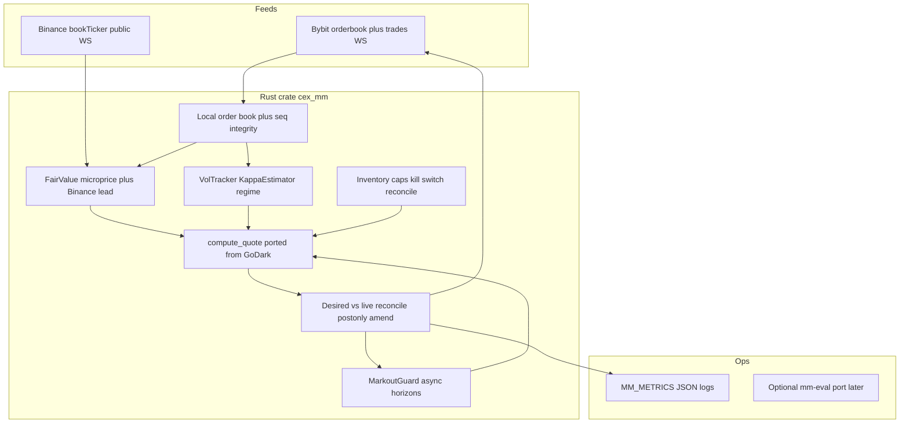

# CEX market-making bot — build plan (Lead Engineer reviewed)

## Decisions (from your review inputs)


| Decision         | Choice                                                                                                                                                                 |
| ---------------- | ---------------------------------------------------------------------------------------------------------------------------------------------------------------------- |
| Language         | **Rust** from day one (adapt [strategy.rs](crypto-strategy/resource/godark-mm-bot/mms/vanilla-mm-rust/src/strategy.rs) + new venue layer; do not depend on GoDark SDK) |
| First venue      | **Bybit USDT linear perps** ([R3](crypto-strategy/resource/03-exchange-apis-okx-binance-bybit.md))                                                                     |
| First market     | One **mid-cap alt** with natural spread ≥ 2–3 ticks (not BTC/ETH at 1 tick) — pick after Phase 0 recorder stats                                                        |
| Deployment       | **Local WSL** for dev + Bybit testnet; document Singapore VM cutover before mainnet                                                                                    |
| Design authority | [STRATEGY.md](crypto-strategy/STRATEGY.md) + research R1–R5 + [06-godark](crypto-strategy/resource/06-godark-vanilla-mm-strategy-analysis.md) (GoDark = execution baseline, not sole strategy) |
| GoDark reference | [resource/godark-mm-bot/mms/vanilla-mm-rust/](crypto-strategy/resource/godark-mm-bot/mms/vanilla-mm-rust/) (read-only reference; new code lives outside `resource/`)   |

## Testnet first, mainnet only on evidence

**Your rollout:** run on **Bybit testnet** until the **system** is proven; move to **mainnet** only when the **strategy** is proven on **real** microstructure.

| Stage | What testnet proves | What testnet does NOT prove |
|-------|---------------------|-----------------------------|
| Testnet (Slices 2–6) | API/WS plumbing, post-only/amend, reconcile, kill switch, markout **pipeline**, attribution math | Profitable MM, queue position, adverse selection, “making good money” |
| Mainnet micro (Slice 8) | Net quoter edge: `spread + rebate − adverse − fees`; toxicity ratio; snipe rate | Scale, VIP tiers, multi-pair portfolio |
| Scale | Widen only on markout evidence (GoDark `mm-eval` guards + R2 consensus) | — |

**Promotion to mainnet requires ALL of:**

1. Testnet: fire-drill + 72h stable run with zero unreconciled orders/positions and working markout logs.
2. **Backtest or mainnet recorder (Slice 7/7b):** hftbacktest with queue + latency on ≥1 week data; not bar-based sim (R4, R2 #11).
3. **Mainnet trial:** minimum size, wide half-spread, ≥4 weeks; **quoter score** (inventory-zeroed) ≥ 0; toxicity `< 0.7` at 10s (R5); exchange realized PnL reconciled to attribution.
4. **Do not** promote because testnet balance went up — testnet books are thin and non-representative (R3).

Optional: parallel **OKX demo** or **Binance demo-fapi** for second-venue plumbing before mainnet (keys in plan below).

## Research crosswalk: plan vs R1–R5 (Lead Engineer review)

GoDark + current plan already cover much of practitioner and risk research. Gaps below are **added to slices** so we are not “GoDark-only.”

| Research theme | Source | Already in plan (GoDark/STRATEGY) | Gap → plan change |
|----------------|--------|-----------------------------------|-------------------|
| Fair value ≠ mid; microprice | R1 §7–8, R2 §2 | Microprice blend; Binance lead in Slice 3 | **Slice 3b:** OFI (Cont–Kukanov–Stoikov) drift term on reservation; measure R² live |
| Short-term alpha / adverse selection | R1 §5, R2 §3 | Markout guard, fee floor | **Slice 3b:** `s/2 ≥ α·μ` floor from own 1m markouts (R5 §1.5); **snipe_rate** after Binance jumps |
| GLFT asymptotic vs AS finite-T | R1 §2–4 | GoDark AS bps + horizon vol | **Slice 7b:** A/B GLFT `c·q` skew vs GoDark reservation; pick winner on backtest |
| Queue / touch quoting toxicity | R2 Daru, Albers | Not in GoDark | **Slice 4:** queue-ahead estimate; cancel back-of-queue on heavy side; avoid 1-tick majors |
| Event-driven quotes | R1 #12, STRATEGY §8 | Planned event loop | Explicit trigger list: fair jump, OFI z-score, vol ratio, inventory band |
| Vol regime L0–L3 | R5 §3, STRATEGY §6.3 | Partial (fair jump only) | **Slice 6b:** σ_short/σ_long, depth collapse, one-sided taker burst → widen/one-side/cancel |
| Flow regime / metaorders | R1 #9, Moret–Lillo | Not in GoDark | **Slice 6b:** z-score on signed trade flow; pull run-over side |
| Funding on perps | R1 #14, R2 §7 | Not in GoDark | **Slice 6b:** `−q·f` in reservation; pause amends ±5s around funding (OKX lesson → apply on Bybit too) |
| Hedging band | R1 #6, R5 §2 | Reduce-only over-cap only | Phase 2: taker hedge past soft limit (document in Slice 6; implement after mainnet micro) |
| Kill switch K1–K12 | R5 §7 | Partial K3–K7 in Slice 6 | **Slice 6b:** calendar CPI/FOMC pause; composite ref deviation; daily loss halt |
| Backtest with queue + latency | R4, R2 #11 | Slice 7 stub | **Slice 7b:** hftbacktest `RiskAdverseQueueModel`; pin 2.4.4; Bybit ob500 or self-recorded |
| OFI / BBO alpha (hftbacktest) | R4 notebooks | Not planned | Optional Phase 2: VAMP/OBI into fair (after baseline profitable) |
| RL / ML MM | R1 §10 | Out of scope | Stay out until analytic baseline profitable on mainnet (R1 #16) |
| OSS eval guards | R6 + GoDark | Deferred | Port `mm-eval.py` guards after Slice 5 (block tighten if avg30s < −5 bps) |

**Verdict:** The plan is **directionally correct** but was **over-weighted on GoDark port**. With Slice **3b**, **6b**, and **7b**, it aligns with academic + practitioner consensus without scope creep into RL.

## Unified strategy formula (research + GoDark)

**Keep from GoDark (R6 must-reuse):** `compute_quote` stack, side-aware `MarkoutGuard`, κ/vol estimators, inventory one-sided + size shape, fair-jump defense, eval guards.

**Add from R1–R5 (new in this plan revision):**

```
FV = microprice_native + w_lead·(binance_mid − venue_mid) + β·OFI_window
reservation = FV · (1 − GoDark_skew_terms) + funding_carry(q)
half_spread = max(AS_or_GLFT_half, fee_half, α·μ, dynamic_adverse_min)
              × vol_regime_multiplier(L0–L3)
```

**Pair selection (R2, R3):** mid-cap perp, spread ≥ 2–3 ticks; rank candidates from Slice 1 recorder (spread, depth, vol, lead-lag).

## Target architecture




**Control loop:** event-driven re-quote (book/fair/inventory/regime), with **max quote age ~30s** and **amend hysteresis** (≥1 tick / ≥10% size), target cycle **200–250 ms** when active ([STRATEGY.md §8](crypto-strategy/STRATEGY.md)).

**Quote engine:** Port GoDark `compute_quote`, `MarkoutGuard`, `VolTracker`, `KappaEstimator`, `quote_side_flags`, `signed_fill_markout_bps` first (GoDark `strategy.rs` unit tests = acceptance spec). Then extend fair/reservation per **Unified strategy formula** (OFI, funding, regime mult) in Slices 3b/6b. Replace GoDark fair stack: **native Bybit L2 + Binance lead** (no Pyth/oracle).

## Repository layout (new code)

Under [crypto-strategy/](crypto-strategy/):

```
crypto-strategy/
  STRATEGY.md, README.md, resource/     # unchanged role
  cex-mm/                               # NEW Rust workspace
    Cargo.toml
    crates/
      mm-core/          # strategy, config, metrics (ported from GoDark strategy.rs)
      mm-bybit/         # WS public + private, REST fallback, order types
      mm-binance/       # read-only reference feed (bookTicker)
      mm-bot/           # binary: one symbol per process
    config/
      example.env       # no secrets
    scripts/
      run-testnet.sh
    tests/
      integration/      # testnet smoke (ignored in CI without keys)
```

Add `.gitignore`: `target/`, `.env`, `artifacts/`, `*.log`. **Never commit API secrets.**

## API keys and credentials you need

Provide secrets via a **local file** (e.g. `cex-mm/.env`, gitignored) or your existing secrets pattern — not in chat logs.

### Required for Phase 0–2 (build + Bybit testnet)


| Key / credential                   | Exchange                                                        | Purpose                                                           | Permissions                                                                                |
| ---------------------------------- | --------------------------------------------------------------- | ----------------------------------------------------------------- | ------------------------------------------------------------------------------------------ |
| **Bybit testnet API key + secret** | [Bybit testnet](https://bybit-exchange.github.io/docs/v5/guide) | Place/cancel/amend post-only orders; private fills/positions      | **Read + Trade only**; **no Withdraw**; optional IP whitelist (skip on WSL until fixed IP) |
| *(none)*                           | Binance                                                         | **Public** `bookTicker` / `aggTrade` WebSocket for reference fair | No API key needed for public market data                                                   |


### Required before mainnet live (Phase 3+)


| Key / credential                              | Exchange     | Purpose                                                          | Permissions                                                      |
| --------------------------------------------- | ------------ | ---------------------------------------------------------------- | ---------------------------------------------------------------- |
| **Bybit mainnet API key + secret**            | Bybit linear | Live MM on chosen symbol                                         | Read + Trade; no Withdraw; **IP whitelist** once on Singapore VM |
| **Second Bybit key (recommended)**            | Bybit        | Watchdog / emergency `cancel-all` only                           | Trade-only on same sub-account or dedicated kill sub-account     |
| **Binance USD-M or spot read key** (optional) | Binance      | If public WS is rate-limited or you need authenticated endpoints | **Read only**                                                    |


### Later phases (OKX / Binance quoting)


| Key                                   | Notes                                                                                                     |
| ------------------------------------- | --------------------------------------------------------------------------------------------------------- |
| **OKX API key + secret + passphrase** | Demo: header `x-simulated-trading: 1` + demo keys; live: separate keys                                    |
| **Binance USD-M API key + secret**    | Demo-fapi for plumbing; live: Read + Trade, no Withdraw; consider **Ed25519** for user-data stream per R3 |
| **Sub-accounts**                      | One sub-account per strategy × venue (isolation + rate limits)                                            |


### Non-exchange (optional)


| Item                   | When                                                                          |
| ---------------------- | ----------------------------------------------------------------------------- |
| **Tardis.dev API key** | Phase 1 backtest if you buy history ($350/mo); not required if self-recording |
| **AWS account**        | When moving off WSL to ap-southeast-1                                         |


### Key hygiene (non-negotiable, R5)

- Trade permission only; withdraw disabled; document key label and creation date.
- Separate **testnet vs mainnet** keys.
- Enable **STP/SMP** on every order (Bybit `smpType`, etc.).
- Store in `.env` / secrets manager; bot logs must redact keys.

## Global acceptance criteria (product)

1. **Markout before edge claims:** every passive fill logged with signed markout at 1s, 5s, 30s (extend to 100ms/1m/5m by Phase 3); daily attribution: spread + rebate − adverse − fees (inventory zeroed for quoter score).
2. **Post-only always;** no accidental taker except reduce-only flatten.
3. **Book integrity:** on seq gap or staleness > 500ms → cancel quotes on that symbol before re-quote.
4. **Kill path:** manual + automatic cancel-all; reconciliation loop detects position/order drift.
5. **Exchange PnL is truth;** internal economics for debug only (GoDark `FillEconomics` pattern).

## Vertical slices (Lead Engineer delivery)

Each slice: **engineer subagent implements** → **Lead five-axis review** → **QA subagent** (or Lead checks) with pasted test/output evidence → then next slice.

### Slice 0 — Project scaffold + pure quote engine (S)

- **Work:** Create `cex-mm/` workspace; copy/adapt `mm-core` from GoDark `strategy.rs` + all `mod tests`; `StrategyConfig` from env/TOML; remove GoDark-only fields.
- **Acceptance:** `cargo test -p mm-core` passes; tests match GoDark semantics for `compute_quote`, markout sign, reservation, one-sided flags.
- **Verify:** `cd crypto-strategy/cex-mm && cargo test -p mm-core`

### Slice 1 — Market data recorder (S)

- **Work:** Bybit public WS (`orderbook.50`, `publicTrade`, `tickers`); Binance public `bookTicker`; write Parquet or JSONL with **local timestamp**; instrument metadata at startup.
- **Acceptance:** 1h recording run produces valid files; book resync on `u==1`.
- **Verify:** `cargo run -p mm-bot -- record --symbol ... --duration 3600`

### Slice 2 — Bybit testnet adapter (M)

- **Work:** `mm-bybit`: auth, private WS (order/execution/position), WS trade + REST fallback, post-only limits, amend-batch, cancel-all, `instruments-info` tick/lot/min notional.
- **Acceptance:** Integration test (ignored without keys): place post-only → amend → cancel; reject crossing post-only handled.
- **Verify:** `cargo test -p mm-bybit -- --ignored` with `.env`

### Slice 3 — Fair value + estimators (S)

- **Work:** Microprice from Bybit `BookTop`; Binance mid lead adjustment; `VolTracker` + `horizon_vol_bps`; `KappaEstimator` + optional tape from public trades; warm-up gate before quote.
- **Acceptance:** Unit tests for fair jump detection; κ/vol finite on synthetic series.
- **Verify:** `cargo test -p mm-core -p mm-bybit`

### Slice 3b — Short-term alpha + toxicity floor (S) — R1/R2/R5

- **Work:** Rolling OFI from L1/book events; `β·OFI` shift on reservation (Cont–Kukanov–Stoikov); estimate `α·μ` from rolling 1m markouts → minimum half-spread; **snipe_rate** = fills within 500ms after Binance-led fair jump (R2 §3.5–3.6).
- **Acceptance:** Unit tests on synthetic OFI; spread floor rises when injected adverse markout series high.
- **Verify:** `cargo test -p mm-core`; metrics expose `ofi_beta`, `alpha_mu_bps`, `snipe_rate`
- **Depends on:** Slice 3 (fair), Slice 5 for real markouts (can ship with simulated markouts first)

### Slice 4 — OMS + event loop (M)

- **Work:** Desired-vs-live diff (BitMEX `converge_orders` pattern); rate budget ≤70% of 10/s; hysteresis; one symbol process; `MM_METRICS` JSON line; **queue-ahead estimate** at placement; cancel amend target if back-of-queue on side facing imbalance (R2 Albers/Daru).
- **Acceptance:** Dry-run mode computes quotes on live book without orders; live testnet places 2 levels/side and maintains within tolerance.
- **Verify:** testnet run 30 min, logs show metrics + no reject storm

### Slice 5 — Markout guard + fill economics (M)

- **Work:** On fill from execution WS: spawn horizon tasks (1/5/30s), worst-case side-aware widen, decay; `FillEconomics` + startup position reconcile vs venue.
- **Acceptance:** Simulated fill injection test widens correct side only; economics JSON persists restart.
- **Verify:** unit + short testnet session with intentional small size

### Slice 6 — Risk + kill switch (M)

- **Work:** Inventory soft/hard, over-cap cancel at 1.05×, reduce-only IOC flatten, fair-jump defensive one-sided, K3–K7 subset (staleness, reject storm, daily loss limit env); optional second-key cancel script.
- **Acceptance:** Table-driven tests for triggers; manual fire-drill on testnet cancels all within 2s.
- **Verify:** documented fire-drill checklist passed once

### Slice 6b — Regime ladder, funding, calendar (M) — R5/R2

- **Work:** L0–L3 vol regime (σ_short/σ_long, jump, one-sided depth/trade burst); multiply spread or one-side/cancel-all; **funding carry** in reservation from ticker; optional CPI/FOMC calendar cancel window; signed-flow z-score metaorder guard (R1 #9).
- **Acceptance:** Table-driven regime transitions with hysteresis; funding term changes reservation sign in unit test.
- **Verify:** `cargo test -p mm-core`; testnet inject vol spike → observes L1+ widen in metrics
- **Depends on:** Slice 6 base kill switch

### Slice 7 — Backtest hook (S, parallelizable after Slice 1)

- **Work:** Export recorder format → hftbacktest-compatible pipeline (or in-crate replay stub); run GoDark-calibrated params on 1 week Bybit ob500 if downloaded.
- **Acceptance:** Backtest report: mean net markout proxy + fee; documents assumptions (queue model).
- **Verify:** script documented in `cex-mm/README.md`

### Slice 7b — hftbacktest + GLFT calibration (S) — R4/R1

- **Work:** Python/Rust bridge or export path to **hftbacktest 2.4.4**; `RiskAdverseQueueModel`; calibrate A,k,σ per hftbacktest GLFT notebook; compare net markout vs GoDark AS params on same week of data.
- **Acceptance:** Report: GoDark AS vs GLFT skew/spread on identical replay; document queue/latency assumptions.
- **Verify:** documented command in `cex-mm/README.md`; outputs saved under `cex-mm/artifacts/backtest/`
- **Gate:** Required before mainnet promotion (with testnet plumbing pass)

### Slice 8 — Mainnet small live (gate, not code-heavy)

- **Work:** Pick symbol from recorder; wide half-spread; min size; 48h then 4 weeks per [STRATEGY.md §11.3](crypto-strategy/STRATEGY.md).
- **Acceptance:** toxicity ratio < 0.7 at 10s; no unreconciled positions; positive quoter score trend.
- **Verify:** attribution report + exchange realized PnL screenshot/export

## Lead Engineer review checklist (applied every slice)


| Axis         | Gate                                                                  |
| ------------ | --------------------------------------------------------------------- |
| Correctness  | Matches STRATEGY + GoDark `compute_quote` spec; tests assert behavior |
| Readability  | Clear module boundaries: core vs bybit vs bot                         |
| Architecture | No GoDark SDK; venue traits for later OKX/Binance                     |
| Security     | No secrets in repo/logs; input validation on WS payloads              |
| Performance  | No unbounded channels; rate-limit aware OMS                           |


**QA:** Separate pass — run tests, testnet smoke, markout log sanity, error paths (disconnect, 429).

## Out of scope (initial build)

- OKX/Binance **quoting** adapters (stub trait only).
- RL / auto-tune (`mm-eval.py` port) until live markouts exist.
- Timescale/Grafana stack (structured logs first).
- MM programme / VIP tier optimization.
- Pruning [godark-mm-bot/mms/artifacts/](crypto-strategy/resource/godark-mm-bot/mms/artifacts/) (~1.4GB) — optional cleanup task, not blocking.

## Risks and mitigations


| Risk                                            | Mitigation                                                           |
| ----------------------------------------------- | -------------------------------------------------------------------- |
| Testnet fills ≠ mainnet queue/adverse selection | Gate on **mainnet small size** + markout, not testnet PnL alone (R3) |
| “Good money on testnet” false confidence | Promotion checklist §Testnet first; testnet validates **code**, mainnet validates **edge** |
| GoDark-only misses OFI/regime/queue | Slices **3b, 4 queue, 6b, 7b** close R1–R5 gaps |
| WSL latency vs Singapore                        | Accept for testnet; migrate host before tightening spreads           |
| `MM_VOL_SPREAD_MULT` dead in GoDark             | Do not port until wired into spread, or omit from config             |
| Binance public WS blocked/rate-limited          | Fallback: read-only API key or co-located recorder later             |


## After you approve this plan

1. You provide **Bybit testnet** API key + secret (via `.env`, not chat).
2. Lead Engineer spawns **Slice 0** implementer, then review → QA loop per slice.
3. Optional: init git in `crypto-strategy/cex-mm` only when you ask to commit.

## Lead Engineer sign-off on this plan

This plan satisfies Lead Engineer **§1 Plan**: testable acceptance criteria, **S/M vertical slices**, dependencies ordered (core → feeds → venue → fair/alpha → loop → markout → risk/regime → backtest → mainnet gate), secrets excluded from repo, and **implement-via-subagent + review + QA** for each slice.

**Second-pass review (research vs GoDark):** Strategy is **hybrid** — GoDark for proven MM control loop and markout defense; R1–R5 for fair-value alpha, queue, regime, funding, backtest rigor, and mainnet promotion gates. Testnet-first rollout is explicit; mainnet requires markout/backtest evidence, not testnet profit.

No feature code until you confirm the plan.