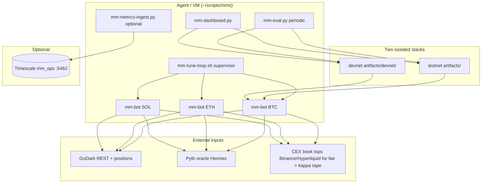

# GoDark vanilla MM strategy — architecture, math, and CEX porting guide

**Audience:** Engineers or agents porting this market-making logic to **centralized exchanges** (Binance, OKX, Bybit, etc.) without access to the GoDark codebase.

**Source of truth in our tree:** `~/scripts/mms/vanilla-mm-rust/` (Rust binary) plus ops scripts under `~/scripts/mms/`.

**Last updated:** 2026-09-21 (includes side-aware markout, venue reconcile, Timescale ingest, archived dashboard merge).

---

## 1. Scope and philosophy

### What this strategy is

- A **post-only market maker** on **perpetual/swaps** (currently **BTC-USDC-PERP**, **ETH-USDC-PERP**, **SOL-USDC-PERP**).
- Goal: earn **closed round-trip spread after fees**, not predict direction.
- One **symbol = one process = one API key** (three parallel bots per stack).

### What this strategy is not

- Not HFT colocation, not latency arb, not grid trading, not copy-trading production params.
- Not guaranteed positive PnL: profit depends on **spread − fees − adverse selection (markout)** on leftover inventory.

### Success metric

```
edge ≈ quoted_spread − maker_fees (both legs) − signed_markout on fills
```

Use **exchange realized PnL** as ground truth; bot counters are for debugging and survive restarts only where persisted.

---

## 2. GoDark platform (context for the other agent)

**GoDark** is a decentralized perpetuals exchange operated by GoQuant. We run against:

| Environment | Typical UI / API | Our use |
|-------------|------------------|---------|
| **Testnet** | Public testnet app | Primary MM validation; higher volume, ~+$600+ realized on test account over recent weeks |
| **Devnet** | Devnet app | Thinner book, shared infra; stricter overlays (SOL de-risk, REST backoff) |

**You do not need the GoDark repo** to reuse the **quote math and risk controls** below. You **do** need a CEX adapter for:

- Authenticated REST/WebSocket (orders, positions, balances)
- **Post-only / maker** limit orders
- Tick size, lot size, min notional
- Position/inventory in base coin (signed: long +, short −)

Official GoDark API docs (for humans): [https://docs.godarkdex.com/](https://docs.godarkdex.com/)

Our bot uses the **Rust SDK** (`gdx-rust-sdk`) internally for handshake, HPKE session, `mass_quote`-style place/cancel, and position reads. **Port the strategy layer**, not the wire protocol, to CEX.

---

## 3. Where we run (deployment architecture)



| Component | Path / command |
|-----------|----------------|
| **Testnet daemon** | `bash ~/scripts/mms/start-mm-daemon.sh` |
| **Devnet daemon** | `bash ~/scripts/mms/start-mm-devnet-daemon.sh` |
| **Logs** | `artifacts/mm-bot-{BTC,ETH,SOL}.log` (per stack) |
| **Tuning (eval output)** | `artifacts/mm-tuning.env` / `artifacts/devnet/mm-tuning.env` |
| **Runtime overlays** | `mm-tuning-testnet.env`, `mm-tuning-devnet.env` (not overwritten by eval) |
| **Economics persist** | `mm-bot-{SYM}-economics.json` (realized, fees, fill count, internal position) |
| **Dashboard** | `python3 ~/scripts/mms/mm-dashboard.py` → `artifacts/mm-dashboard.html` |
| **MM DB** | `bash ~/scripts/mms/start-mm-db.sh` + optional `start-mm-metrics-ingest.sh` |

**Loop timing:** default **15s** per symbol (`MM_LOOP_INTERVAL_SEC`), staggered via `MM_LOOP_OFFSET_SEC` per symbol to reduce API bursts.

---

## 4. Control loop (one symbol)

Each loop iteration:

1. **Refresh auth** (GoDark session); on 429, global REST backoff.
2. **Read positions** → signed inventory `q`, unrealized PnL, mark price.
3. **Venue reconcile (once):** sync internal economics `position` to venue if drift &gt; tolerance (realized/fees unchanged).
4. **Fair price** `m` from book/oracle/mark blend (see §5).
5. **Vol** from rolling log returns of fair; scale to AS horizon (`horizon_vol_bps`).
6. **κ (kappa)** from recent fill distances + optional external trade tape blend.
7. **Markout guard** decay; read side-specific extra spread (`bid` / `ask`).
8. **Compute quotes:** reservation price, bid/ask, sizes, which sides to post.
9. **Over-cap:** if `|q| > max_inv`, cancel all and optional reduce-only unwind clip.
10. **Place/cancel** resting limits (post-only), skip replace if within tolerance bps.
11. **On inventory change (fill):** log multi-horizon markout (1s, 5s, 30s); widen **bid or ask** on adverse markout; update economics JSON.

Structured metrics line: `MM_METRICS {json}` every loop.

---

## 5. Fair price

Priority chain (`resolve_fair_price`):

1. **Live book** (if market data enabled): blend mid and **microprice**  
   `fair = (1 − w) × mid + w × microprice`, default `w = MM_MICROPRICE_WEIGHT` (0.3).
2. **Oracle blend:** Pyth price via instrument feed id, weight `MM_ORACLE_BLEND_WEIGHT` (0.35).
3. **Position mark** from exchange when book/oracle weak.
4. **Static fallback** per symbol (`MM_FAIR_FALLBACK_BTC`, etc.).

**External reference books** (for fair and κ tape, not for order placement): configurable `MM_BOOK_SOURCE` (e.g. `hyperliquid,binance`) — useful on GoDark; on CEX you typically use **native L2** only.

**Fair jump:** if `|m/m_prev − 1| × 10⁴ ≥ MM_FAIR_JUMP_BPS` (12): widen spread; optional **defensive one-sided** (drop bid on up-jump, drop ask on down-jump).

---

## 6. Core formulas

Notation:

| Symbol | Meaning |
|--------|---------|
| `m` | Fair price |
| `q` | Signed inventory (base); `q/max_inv` → `inv_ratio ∈ [−1, 1]` |
| `s` | Half-spread in **bps** (per side, before asymmetry) |
| `γ` | Risk aversion `MM_AS_GAMMA` (0.35) |
| `κ` | Order arrival intensity `MM_AS_KAPPA` or estimated |
| `σ` | Volatility (bps), horizon-scaled |

### 6.1 Avellaneda–Stoikov half-spread (bps)

```
σ_frac = vol_bps / 10_000
vol_term = 0.5 × γ × σ_frac² × 10_000
arrival  = (2/γ) × ln(1 + γ/κ) × MM_AS_ARRIVAL_SCALE
as_half  = vol_term + arrival
```

Then:

```
fee_half = (2 × maker_fee_bps + MM_ADVERSE_BUFFER_BPS) / 2
half_spread = max(as_half, fee_half, MM_MIN_HALF_SPREAD_BPS)
```

Optional **dynamic min** when rolling adverse markout magnitude is high:

```
min_half = max(min_half, fee_half + rolling_adverse_bps/2 + MM_MARKOUT_MIN_BUFFER_BPS/2)
```

**Stress floor:** `MM_HALF_SPREAD_BPS` acts as per-side floor when markout guard is active on that side.

**Calm tightening:** if no markout extra and `vol_bps ≤ MM_CALM_VOL_THRESHOLD_BPS`, pull `half_spread` toward fee floor by factor `MM_CALM_SPREAD_DISCOUNT`.

**Inventory widen:** multiply `half_spread` when `|q|` exceeds soft ratio `MM_INV_SOFT_RATIO`.

### 6.2 Reservation price (inventory skew)

Normalized inventory ratio `r = q / max_inv`.

```
skew_component = r × MM_INVENTORY_SKEW_BPS / 10_000
vol_penalty    = r × γ × (vol_bps/10_000)²
boundary       = r³ × MM_BOUNDARY_SKEW_BPS / 10_000   # GLFT-style near limits
book_skew      = f(order book imbalance) × MM_BOOK_IMBALANCE_SKEW_BPS

reservation = m × (1 − skew_component − vol_penalty − boundary + book_skew)
```

Long inventory → reservation **below** fair → quotes shift down to attract sells.

### 6.3 Asymmetric half-spreads (inventory-aware)

```
asym = MM_ASYM_SPREAD_FACTOR
bid_half = half_spread × (1 + max(r,0) × asym) + markout_extra_bid_bps
ask_half = half_spread × (1 + max(−r,0) × asym) + markout_extra_ask_bps
```

Quotes:

```
bid = round_to_tick(reservation × (1 − bid_half/10_000))
ask = round_to_tick(reservation × (1 + ask_half/10_000))
```

**Post-only clamp:** bid &lt; fair, ask &gt; fair, bid &lt; ask.

### 6.4 One-sided quoting

When `|q| ≥ max_inv` → only reduce side.  
Soft cap: `|q| ≥ max_inv × MM_INV_ONE_SIDED_RATIO` → stop adding on heavy side (symbol-specific `MM_INV_ONE_SIDED_RATIO_SOL`, etc.).

### 6.5 Order size

Base `MM_ORDER_QTY_{SYMBOL}`; shrink with `|r|` via `MM_SIZE_SHAPE_FACTOR` (minimum 15% of base).

### 6.6 Signed markout (adverse selection)

At fill, fair at fill `m₀`, fair after horizon `m₁`, bought flag:

```
raw_bps = (m₁/m₀ − 1) × 10_000
signed_bps = −raw_bps   if bought
           = +raw_bps   if sold
```

Negative signed markout = **toxic fill** (price moved against you).

**Guard (multi-horizon 1s, 5s, 30s):** worst signed markout across horizons; if &lt; `−MM_MARKOUT_THRESHOLD_BPS`, add `MM_MARKOUT_WIDEN_BPS` to:

- **Side-aware (default):** bid only if buy fill, ask only if sell fill.
- **Legacy symmetric:** both sides if `MM_MARKOUT_SIDE_AWARE=0`.

Extras decay each loop: `× MM_MARKOUT_DECAY` (0.85).

### 6.7 κ estimation

- **From fills:** median distance (fair → fill) in bps → `κ ≈ ln(2) / median_bps`.
- **From tape:** bucket trade prices vs mid, exponential fit (GLFT-style).
- **Blend:** `effective_κ = blend × κ_tape + (1−blend) × κ_fill`, clamped `[MM_KAPPA_FLOOR, MM_KAPPA_CAP]`.

### 6.8 PnL accounting (bot-side)

Avg-cost inventory model on fills:

- Realized when closing/reducing position.
- Fees: `notional × MM_MAKER_FEE_BPS / 10_000` per fill leg.
- Persisted to `mm-bot-{SYM}-economics.json`; **venue reconcile** fixes position drift on startup.

---

## 7. Risk and safety

| Mechanism | Env / behavior |
|-----------|----------------|
| Hard inventory cap | `MM_MAX_INVENTORY_{SYMBOL}` |
| Over-cap cancel all | `|q| > 1.05 × max` |
| Over-cap unwind | Optional reduce-only market/limit clip (`over_cap_unwind`) |
| Rate limits | HTTP 429 → shared backoff; devnet `MM_REST_PAUSE_MS` |
| Min notional | Per-symbol floors; skip quote if size below exchange min |
| Cancel tolerance | Skip cancel/replace if bid/ask drift &lt; tolerance bps |
| Auth refresh | Periodic token refresh; streak logging |

---

## 8. Measurement, eval, and tuning

| Tool | Role |
|------|------|
| `MM_METRICS` / `MM_MARKOUT_HORIZON` logs | Time series, markout by side |
| `mm_markout.py` | Parse 30s markouts for dashboard/eval |
| `mm-dashboard.py` | HTML + JSON; merges **archived runs** (`MM_DASHBOARD_INCLUDE_ARCHIVED=1`) |
| `mm-benchmark-scorecard.py` | Tier A checks (toxic SOL, bad buy markout, etc.) |
| `mm-eval.py` | Writes `mm-tuning.env`; **guards:** no spread tighten if avg 30s &lt; −5 bps or buy &lt; −15 bps; no size-up on toxic buys |
| **Overlays** | Testnet SOL de-risk; devnet thin-book + SOL caps — applied at bot start, not removed by eval |

**Separate eval files** for testnet vs devnet — never share one tuning file across environments.

---

## 9. Improvements over time (what moved PnL)

Chronological themes from our iteration (Sep 2026):

| Phase | Change | Why it mattered |
|-------|--------|-----------------|
| **Vanilla baseline** | AS half-spread + fee floor + inventory reservation skew | Stable quoting framework |
| **Vol + horizon σ** | Realized vol tracker, sqrt-time scaling to holding horizon | Spread widens in fast markets |
| **κ from fills + tape** | Data-driven arrival term instead of fixed κ only | Less arbitrary width; still clamped |
| **Fair stack** | Microprice blend, Pyth oracle, external book reference | Less stale fair on GoDark |
| **Inventory** | One-sided soft cap, boundary skew, size shaping | Less stuck at max long/short |
| **Markout guard** | Multi-horizon logging + symmetric widen | First adverse-selection defense |
| **Stack split** | Separate testnet/devnet tuning + devnet overlay | Devnet stopped inheriting testnet aggression |
| **SOL de-risk** | Smaller clips, lower max inv, stronger skew (esp. testnet overlay) | SOL was main toxic-buy symbol |
| **Eval guards** | Block auto-tighten / size-up when markouts bad | Prevent eval from undoing gains |
| **Economics persist + venue reconcile** | JSON survive restart; position sync to venue | Metrics match FE better |
| **Side-aware markout** | Widen bid only on toxic buys (devnet −45 bps buy problem) | Targets adverse selection without killing ask edge |
| **Observability** | Dashboard 1D/1W, scorecard, optional Timescale ingest | Faster RCA, weekend attribution |

**Empirical result (GoDark FE, approximate):** testnet strong weekend on **BTC/ETH** churn (~+$400–650 realized trajectory); devnet lagged due to **thinner liquidity**, **tighter effective spread**, and **SOL buy toxicity** until overlays + side-aware guard.

---

## 10. Porting to Binance / OKX / Bybit

### 10.1 Keep (strategy core)

- Entire **§6 math** and **§7 risk** state machine.
- Markout guard with **side-aware** widen.
- Inventory one-sided logic and reservation skew.
- Eval philosophy: **one knob at a time**, markout-gated tuning.

### 10.2 Replace (venue adapter)

| GoDark | CEX |
|--------|-----|
| HPKE + mass quote API | REST `POST /order` + WS user stream |
| `symbol_id` | Unified symbol string (`BTCUSDT`) |
| GoDark positions API | Exchange position risk / account endpoints |
| Pyth oracle fair | Index/mark price from exchange or external index |
| Our external Binance book for fair | **Native L2** from same exchange |

### 10.3 CEX-specific checks

- **Maker fee tier** → set `MM_MAKER_FEE_BPS` from VIP tier API.
- **Post-only** flag on every limit (Binance `GTX`, etc.).
- **Reduce-only** for over-cap unwind.
- **Rate limits** per endpoint; often stricter than GoDark — increase `MM_LOOP_INTERVAL_SEC` or coalesce cancels.
- **Funding** on perps affects PnL but not quote math — track separately in PnL reports.
- **Cross vs isolated margin** — align `max_inv` with margin mode.

### 10.4 Suggested first CEX rollout

1. **One symbol**, smallest `MM_ORDER_QTY`, wide `MM_HALF_SPREAD_BPS`.
2. Log **signed markout 30s** before tightening spread.
3. Match **tick/lot** rounding exactly (copy `round_to_tick` behavior).
4. Run 48h; compare **exchange realized** vs internal economics.
5. Only then enable eval auto-tune with same guards as `mm-eval.py`.

---

## 11. Key environment variables (reference)

| Variable | Typical | Purpose |
|----------|---------|---------|
| `MM_LOOP_INTERVAL_SEC` | 15 | Quote loop period |
| `MM_HALF_SPREAD_BPS` | 57 | Stress half-spread floor |
| `MM_MIN_HALF_SPREAD_BPS` | 12 | Minimum half-spread |
| `MM_MAKER_FEE_BPS` | 2 | Maker fee for floor + economics |
| `MM_ADVERSE_BUFFER_BPS` | 8 | Added to fee floor |
| `MM_AS_GAMMA` / `MM_AS_KAPPA` | 0.35 / 1.5 | AS parameters |
| `MM_INVENTORY_SKEW_BPS` | 30 | Reservation skew strength |
| `MM_MAX_INVENTORY_*` | per coin | Hard cap |
| `MM_MARKOUT_*` | see tuning | Horizons, threshold, widen, decay |
| `MM_MARKOUT_SIDE_AWARE` | 1 | Bid/ask selective widen |
| `MM_VENUE_RECONCILE_POSITION` | 1 | Startup position sync |

Full seed list: `scripts/mms/mm-tuning.env` in the export zip.

---

## 12. Export bundle contents

This guide is included in the zip as:

- `docs/godark-mm-strategy-cex-porting-guide.md` (this file)
- `mms/` — full ops tree: Rust source, shell daemons, Python dashboard/eval, tuning envs, artifacts (logs, economics JSON, archived runs, metrics)

**Excluded from zip:** `vanilla-mm-rust/target/` (Rust build cache; run `cargo build --release` locally).

**Secrets:** No API keys in the zip. GoDark credentials live in `~/.cursor/secrets.env` (not exported).

---

## 13. Contact and iteration rule

When changing live behavior:

1. **One strategy change at a time** per environment.
2. Measure **30s markout by side** and **exchange realized** for ≥48–72h.
3. Use **FE realized** as benchmark; bot JSON for diagnosis.

For GoDark-specific ops, see internal rule `godark-mm.mdc` (not required for CEX port).
